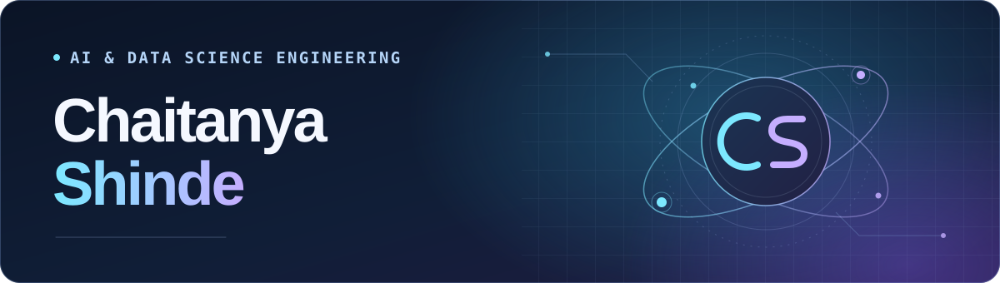

I’m an **AI & Data Science Engineering student** who enjoys taking ideas from sketch to demo. I’m exploring conversational AI with Python and experimenting with interactive web design.

## Featured projects

- **[3D Web Experiment](https://github.com/CHAITANYASHINDE0099/my-3D---website)**  
  A Next.js and TypeScript starter for an interactive 3D website.
- **[Streamlit Chatbot](https://github.com/CHAITANYASHINDE0099/chatbot)**  
  A Python template for experimenting with a conversational interface.

## Tech stack

`Python` · `Streamlit` · `JavaScript` · `TypeScript` · `Next.js`
